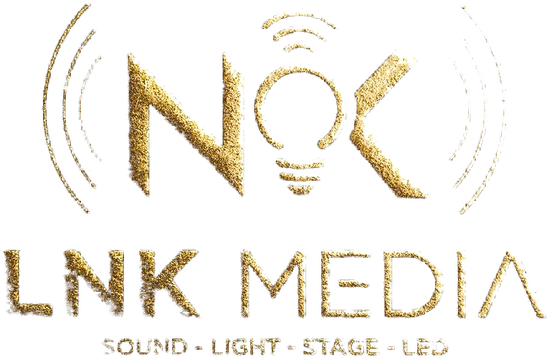

# Lee Nguyễn Media – Bảng phát âm thanh & Màn hình LED

Phát nhạc nền, hiệu ứng, tiếng vỗ tay… chỉ bằng một cú bấm, và điều khiển hình ảnh trên **màn hình LED** như một bàn trộn hình.
Dùng cho quán, sự kiện, sân khấu, livestream. Giao diện tiếng Việt.

| | |
|---|---|
| **Bảng phát âm thanh, YouTube** | **Miễn phí** |
| **Màn hình LED** (trộn hình, Map LED, viền, Chaser…) | **Có tính phí** – chưa mua vẫn dùng thử được (màn LED hiện chữ *"BẢN DÙNG THỬ"*) |
| **Plugin Album ảnh** – biến ảnh thành slide (video) nhanh chóng | **Tính phí riêng** – chưa mua vẫn dùng được (màn LED hiện chữ bản quyền *"BẢN DÙNG THỬ · LNK MEDIA"*) |

## Tải về

  
  &nbsp;
  

  

  

📖 **[Hướng dẫn sử dụng chi tiết (xem online)](https://nguyenlenguyen228-afk.github.io/LeeNguyenMedia-Releases/huong-dan.html)** — cài đặt, bảng phát âm thanh, màn hình LED / YouTube, Map LED và bản quyền, có hình minh hoạ.

👉 Vào mục **[Releases](../../releases/latest)**, tải tệp **`LeeNguyenMedia-win-Setup.exe`** rồi bấm đúp để cài.

- Chạy trên **Windows 10 / 11** (64-bit), không cần cài thêm gì.
- Lần đầu mở, nếu Windows hiện màn hình xanh *"Windows protected your PC"*: bấm **More info** → **Run anyway**.
- Phần mềm **tự kiểm tra và cập nhật** khi có bản mới.

## Tính năng chính

### Bảng phát âm thanh (miễn phí)

- Lưới ô âm thanh: kéo thả file nhạc vào ô, bấm để phát / dừng, phím tắt cho từng ô
- Kịch bản chương trình với nút **GO** cho người chạy show
- EQ tham số (PEQ) từng bài, có sóng nhạc hiển thị trực tiếp
- Cắt ngắn bài nhạc, fade in/out, chuyển bài mượt (crossfade)
- Nhạc nền tự nhỏ khi phát tiếng MC / hiệu ứng (ducking)
- Cân bằng âm lượng tự động (chuẩn LUFS)
- Danh sách phát, phát cả bộ, lặp N lần hoặc mãi mãi
- Mỗi ô chọn loa riêng, nghe trước bằng tai nghe
- Màn hình MC: thời gian còn lại chữ to, đồng hồ phát biểu
- Nút KHẨN CẤP cắt ngay mọi âm thanh
- Phát YouTube lên loa / màn hình phụ

### Màn hình LED (có tính phí – Windows)

- Trộn hình như bàn trộn: màn Xem trước / Đang phát, cắt, chuyển mờ
- Video (mp4, mov, avi, wmv…), ảnh, màu nền, bài YouTube, trình chiếu PDF / PowerPoint (dùng được bút trình chiếu)
- **Map LED**: khai báo cabin, chia vùng, hình có sẵn (tròn, tim, lục giác, ngôi sao, hoa sen…), bút vẽ hình tự do, bo từng góc
- **Viền Map**: liền nét, neon, khói, ma trận, kiếm ánh sáng – chia đoạn chạy đuổi
- **Chaser**: nhấn giữ phím để chớp nháy các vùng làm điểm nhấn, nhiều màu, chỉnh tốc độ
- **Chữ** nhiều kiểu (3D, neon, vàng kim…) và hiệu ứng động, nhiều khối chữ trong một khung
- **Multi View** 10 lớp chồng lên nhau, chỉnh màu sắc (R / G / B) cho từng hiệu ứng

### 🆕 Plugin Album ảnh (tính phí riêng – Windows & Mac, bản 1.3.3.1)

Biến ảnh thành slide (video) nhanh chóng – thả cả thư mục ảnh vào là có ngay:
- Ảnh chạy lần lượt **ngẫu nhiên**, mỗi ảnh **4,3 giây**, chuyển cảnh **0,3 giây** (chỉnh được)
- Chuyển động và chuyển cảnh như ProShow / CapCut – **12 mẫu chạy**: Ken Burns, trượt đẩy, lật thẻ 3D, khối lập phương, khung ảnh…
- **Luôn giữ trọn ảnh**, không cắt người trong ảnh; chỗ trống là chính ảnh phóng to làm nền mờ
- Chạy toàn màn hình như các hiệu ứng khác, theo Map LED / từng màn
- Cách dùng: màn LED → khung **PLUGIN** → kéo **Thêm Album ảnh** vào LAYER → bấm **bánh răng**. Ô **Mã máy** và ô nhập **Giấy phép** nằm ngay trong mục Album ảnh.

**Mua bản quyền màn hình LED:** trong phần mềm bấm nút **Bản quyền** → **Chép mã máy** → gửi mã máy cho LNK MEDIA (☎ 0981.019.019).
Mỗi giấy phép dùng cho một máy, **vĩnh viễn** cho đời bản đã mua (vd 1.3 dùng mãi mọi bản 1.3.x).

---

© 2026 Lee Nguyễn Media · **LNK MEDIA** – Sound · Light · Stage · LED
Bảng phát âm thanh miễn phí; phần màn hình LED có tính phí. Không được bán lại, bẻ khóa hoặc thay đổi tên, logo. Kho này chỉ chứa file cài đặt.
