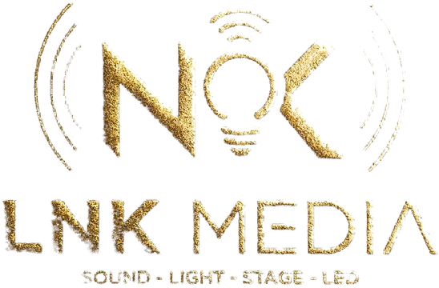

# Lee Nguyễn Media – Bảng phát âm thanh cho Windows

Phần mềm **miễn phí** phát nhạc nền, hiệu ứng, tiếng vỗ tay… chỉ bằng một cú bấm.
Dùng cho quán, sự kiện, sân khấu, livestream. Giao diện tiếng Việt.

## Tải về

👉 Vào mục **[Releases](../../releases/latest)**, tải tệp **`LeeNguyenMedia-win-Setup.exe`** rồi bấm đúp để cài.

- Chạy trên **Windows 10 / 11** (64-bit), không cần cài thêm gì.
- Lần đầu mở, nếu Windows hiện màn hình xanh *"Windows protected your PC"*: bấm **More info** → **Run anyway**.
- Phần mềm **tự kiểm tra và cập nhật** khi có bản mới.

## Tính năng chính

- Lưới ô âm thanh: kéo thả file nhạc vào ô, bấm để phát / dừng, phím tắt cho từng ô
- Kịch bản chương trình với nút **GO** cho người chạy show
- EQ tham số (PEQ) từng bài, có sóng nhạc hiển thị trực tiếp
- Cắt ngắn bài nhạc, fade in/out, chuyển bài mượt (crossfade)
- Nhạc nền tự nhỏ khi phát tiếng MC / hiệu ứng (ducking)
- Cân bằng âm lượng tự động (chuẩn LUFS)
- Danh sách phát, phát cả bộ, lặp N lần hoặc mãi mãi
- Mỗi ô chọn loa riêng, nghe trước bằng tai nghe
- Màn hình MC: thời gian còn lại chữ to, đồng hồ phát biểu
- Nút KHẨN CẤP cắt ngay mọi âm thanh

---

© 2026 Lee Nguyễn Media · **LNK MEDIA** – Sound · Light · Stage · LED
Phần mềm miễn phí; không được bán lại hoặc thay đổi tên, logo. Kho này chỉ chứa file cài đặt.
